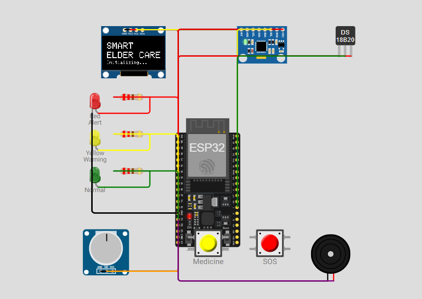
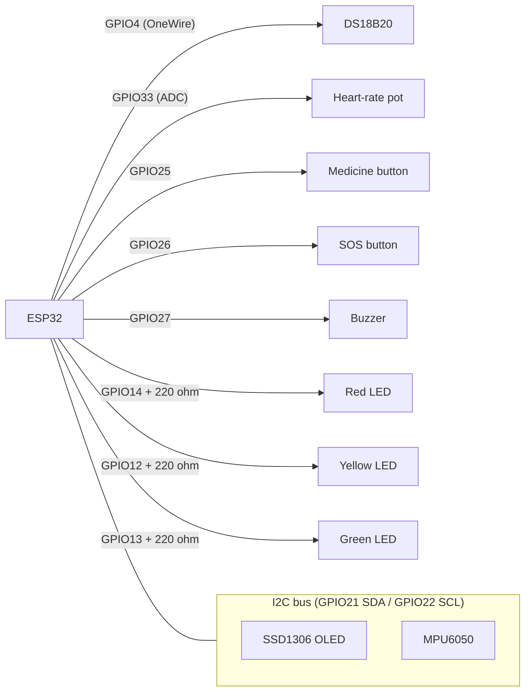
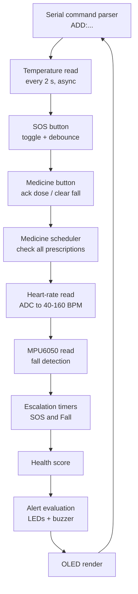

<div align="center">

# 🩺 Smart ElderCare Band

**An ESP32-based wearable for elderly health and medication monitoring: vitals, fall detection, live multi-medicine scheduling, and tiered emergency escalation with simulated GPS.**


</div>

---



## 📑 Table of Contents

1. [Overview](#-overview)
2. [Core Features](#-core-features)
3. [Hardware & Components](#-hardware--components)
4. [Wiring & Pinout Reference](#-wiring--pinout-reference)
5. [System Architecture](#-system-architecture)
6. [Alert Logic](#-alert-logic)
7. [Project Structure](#-project-structure)
8. [Running the Project in Wokwi](#-running-the-project-in-wokwi)
9. [Usage Guide](#-usage-guide)
10. [Configuration Reference](#-configuration-reference)
11. [Known Limitations & Roadmap](#-known-limitations--roadmap)
12. [Team](#-team)
13. [License](#-license)

---

## 📖 Overview

Elderly people living alone or with limited supervision face two recurring risks: **missed medication** and **unnoticed emergencies** such as falls. The **Smart ElderCare Band** is a wrist-worn embedded system built around an **ESP32** that addresses both.

The band continuously reads heart rate, body temperature, and motion; reminds the wearer about each prescribed medicine; and lets the wearer raise a manual **SOS**. If an alert is not acknowledged within the escalation window, the device escalates and, for SOS events, compiles a **Google Maps link from simulated GPS coordinates** for caregivers.

The project is prototyped and tested entirely in the **[Wokwi](https://wokwi.com)** simulator using the included `diagram.json`.

---

## ✨ Core Features

| Feature | Description |
|---|---|
| **Dynamic multi-medicine scheduling** | Add prescriptions at runtime through the Serial Monitor with `ADD:Name,Dose,Slot,Time`. No recompiling or re-flashing. Up to 10 medicines are supported. |
| **Real-time health score engine** | A 0–100 score on the OLED, recalculated every loop from heart rate, body temperature, and fall status. |
| **Automated fall detection** | The MPU6050 total acceleration magnitude is monitored; a spike above **25.0 m/s²** raises a fall alert and starts a 10 s escalation timer. |
| **SOS & GPS escalation** | The SOS button toggles an emergency. If it stays active for 10 s, the device escalates and prints a Google Maps link built from (simulated) GPS coordinates. |
| **Tiered visual and audible alerts** | Green / Yellow / Red LEDs show system state; the buzzer uses different tones for emergencies and reminders. |
| **Rotating prescription display** | The OLED home screen cycles through every scheduled medicine every 3 s. |
| **Non-blocking design** | Temperature conversion is asynchronous and all timing uses `millis()`, so sensors, buttons, and serial input stay responsive. |

---

## 🧰 Hardware & Components

| # | Component | Role | Interface |
|---|---|---|---|
| 1 | **ESP32 DevKit** | Central controller | — |
| 2 | **MPU6050** accelerometer / gyroscope | Motion tracking and fall detection | I²C |
| 3 | **DS18B20** waterproof temperature sensor | Body temperature | OneWire |
| 4 | **Potentiometer** | Analog heart-rate simulation (40–160 BPM) | ADC |
| 5 | **SSD1306 0.96" OLED** (128×64) | UI, splash screen, rotating prescriptions | I²C |
| 6 | **Pushbutton: Medicine** (yellow) | Confirms a dose / clears a fall alert | GPIO (pull-up) |
| 7 | **Pushbutton: SOS** (red) | Manual emergency request (toggle) | GPIO (pull-up) |
| 8 | **Active buzzer** | Audible alerts | GPIO |
| 9 | **LEDs: Red, Yellow, Green** + 3 × **220 Ω** resistors | Multi-tiered status indication | GPIO |

> **Note:** The Wokwi diagram uses the `board-esp32-devkit-c-v4` part. Its GPIO layout is compatible with the ESP32 DevKit V1 used for the physical build.

### Software Libraries

| Library | Purpose |
|---|---|
| `Adafruit SSD1306` | OLED driver |
| `Adafruit GFX Library` | Graphics primitives |
| `Adafruit MPU6050` | IMU driver |
| `Adafruit Unified Sensor` | Sensor abstraction (dependency) |
| `OneWire` | OneWire bus |
| `DallasTemperature` | DS18B20 driver |

---

## 🔌 Wiring & Pinout Reference

### Pin map

| ESP32 GPIO | Connected To | Direction | Notes |
|:---:|---|:---:|---|
| `21` | I²C **SDA** (OLED + MPU6050) | I/O | Shared I²C bus |
| `22` | I²C **SCL** (OLED + MPU6050) | Output | Shared I²C bus |
| `4` | DS18B20 **DQ** | I/O | OneWire data |
| `33` | Potentiometer **SIG** | Input (ADC) | 12-bit read, mapped to 40–160 BPM |
| `25` | **Medicine** button | Input | `INPUT_PULLUP`, active **LOW** |
| `26` | **SOS** button | Input | `INPUT_PULLUP`, active **LOW** |
| `27` | Buzzer (+) | Output | Driven with `tone()` |
| `14` | Red LED (via 220 Ω) | Output | Alert |
| `12` | Yellow LED (via 220 Ω) | Output | Warning |
| `13` | Green LED (via 220 Ω) | Output | Normal |
| `3V3` | OLED, MPU6050, DS18B20, Potentiometer VCC | Power | 3.3 V rail |
| `GND` | All grounds, button/buzzer/LED returns | Power | Common ground |

### I²C addresses

| Device | Address |
|---|---|
| SSD1306 OLED | `0x3C` |
| MPU6050 | `0x68` (default) |

### Connection diagram (logical)



> ⚠️ **Physical build tip:** a real DS18B20 needs a **4.7 kΩ pull-up** between DQ and 3V3. Wokwi does not require it, but real hardware does. The pushbuttons need no external resistors because the internal pull-ups are enabled.

---

## 🏗️ System Architecture

Each pass of `loop()` runs the following pipeline:



---

## 🚦 Alert Logic

### Health score (starts at 100)

| Condition | Penalty |
|---|:---:|
| Heart rate outside 60–100 BPM | −15 |
| Body temperature outside 35.5–37.5 °C | −15 |
| Fall detected | −30 |

### Alert tiers

| Tier | LED | Triggered by |
|---|:---:|---|
| 🔴 **Red (Alert)** | Red | SOS active · fall detected · medicine pending · critical HR (`>120` or `<50` BPM) · critical temperature (`>38.5` or `<35.0` °C) |
| 🟡 **Yellow (Warning)** | Yellow | No red condition, but HR in `100–120` or `50–59` BPM, or temperature in `37.5–38.5` °C |
| 🟢 **Green (Normal)** | Green | All vitals within normal range and no active events |

### Buzzer tones

| Condition | Tone |
|---|:---:|
| SOS or fall active | 1800 Hz |
| Other red alerts (medicine due, critical vitals) | 1000 Hz |
| Yellow / Green | Silent |

### Escalation

| Event | Timeout | Action on timeout |
|---|:---:|---|
| **SOS** (unanswered) | 10 s | Logs an escalation message and prints a Google Maps link, e.g. `https://www.google.com/maps?q=12.9716,77.5946`. Repeats every 10 s while active. |
| **Fall** (unacknowledged) | 10 s | Logs an escalation message ("auto-notifying contacts"). Repeats every 10 s until cleared. |

---

## 📁 Project Structure

```text
smart-eldercare-band/
├── SmartElderCareBand.ino   # Firmware: sensing, scheduling, alerts, UI
├── diagram.json             # Wokwi circuit definition (parts + wiring)
├── libraries.txt            # Wokwi library list (see below)
└── README.md
```

Recommended contents of `libraries.txt` so Wokwi installs dependencies automatically:

```text
Adafruit SSD1306
Adafruit GFX Library
Adafruit MPU6050
Adafruit Unified Sensor
OneWire
DallasTemperature
```

---

## ▶️ Running the Project in Wokwi

### Option A: Wokwi in the browser (quickest)

1. Go to **[wokwi.com](https://wokwi.com)** and create a new **ESP32** project (Arduino).
2. Replace the default sketch with the contents of **`SmartElderCareBand.ino`**.
3. Open the **`diagram.json`** tab and replace its contents with the provided **`diagram.json`**.
4. Open the **Library Manager** (or `libraries.txt`) and add the six libraries listed above.
5. Click **▶ Start Simulation**.
6. Within about 3 seconds the OLED shows the **SMART ELDER CARE** splash screen, then the live dashboard.
7. Open the **Serial Monitor** (baud **115200**) to view events and enter commands.

### Option B: VS Code + Wokwi extension

1. Install **VS Code** and the **Wokwi Simulator** extension (a free licence is required).
2. Build the sketch with PlatformIO or Arduino CLI for the `esp32` target.
3. Add a `wokwi.toml` that points to your compiled firmware and `diagram.json`.
4. Run **Wokwi: Start Simulator** from the command palette.

### Simulating inputs

| To simulate… | Do this in Wokwi |
|---|---|
| **Heart rate** | Turn the potentiometer. Fully left ≈ 40 BPM, fully right ≈ 160 BPM. |
| **Body temperature** | Click the DS18B20 and change its temperature (normal ≈ 36.5 °C). |
| **Fall** | Click the MPU6050 and raise its acceleration so the total magnitude exceeds **25 m/s²**. |
| **SOS** | Click the red button. |
| **Medicine acknowledgement** | Click the yellow button. |

---

## 🕹️ Usage Guide

### Adding a prescription live

In the Serial Monitor (**115200 baud**, line ending: **Newline**), send:

```text
ADD:Name,Dose,Slot,Time
```

Example:

```text
ADD:Vitamin D,1000IU,AFTERNOON,2:00 PM
```

Expected response:

```text
>> [CONFIG] Added Schedule: Vitamin D at 2:00 PM
```

The new medicine immediately joins the rotating list on the OLED. On the OLED, the dose line is shown as `Dose | Slot Time` (e.g. `1000IU | AFTERNOON 2:00 PM`).

> Fields are comma-separated, so **do not use commas inside a field**. Invalid input returns `[ERROR] Invalid format!`, and adding an 11th medicine returns `[ERROR] Medicine list is full!`.

### Button behaviour

| Button | Pressed when… | Effect |
|---|---|---|
| 🟡 **Medicine** | A medicine is pending | Acknowledges the dose and resets that medicine's timer |
| 🟡 **Medicine** | A fall alert is active | Clears the fall alert |
| 🔴 **SOS** | Idle | Activates SOS and starts the 10 s escalation countdown |
| 🔴 **SOS** | SOS active | Cancels SOS |

### Typical serial output

```text
>> System Initialized. Type ADD:Name,Dose,Slot,Time in Serial
>> [EVENT] Medicine Due: Blood Pressure
>> [EVENT] Medicine Acknowledged: Blood Pressure
>> [EVENT] SOS ACTIVATED! Countdown started.
>> [ESCALATION] SOS Unanswered! Alerting contacts...
Map: https://www.google.com/maps?q=12.9716,77.5946
>> [EVENT] Fall Detected!
```

### OLED screens (in priority order)

1. **SOS:** emergency banner with escalation countdown
2. **FALL:** "Check on elder!" with clear instructions
3. **MEDICINE:** medicine name, dose info, and a prompt to press the button
4. **Dashboard:** HR, temperature, health score, and the rotating scheduled-medicine list

---

## ⚙️ Configuration Reference

All tunable values are defined at the top of `SmartElderCareBand.ino`.

| Parameter | Default | Description |
|---|:---:|---|
| `ESCALATION_TIMEOUT` | `10000` ms | Time before SOS / fall alerts escalate |
| `DEBOUNCE_DELAY` | `250` ms | Button debounce interval |
| Fall threshold | `25.0` m/s² | Total acceleration magnitude that triggers a fall |
| Temperature poll interval | `2000` ms | DS18B20 read cycle |
| Display rotation | `3000` ms | Time each medicine stays on the OLED |
| `meds[10]` | 10 slots | Maximum number of prescriptions |
| Default intervals | 2 min / 4 min | Demo intervals for the two built-in medicines |
| Runtime-added interval | 3 min | Demo interval applied to medicines added via `ADD:` |
| `mockGps` | `12.9716, 77.5946` | Simulated GPS position (Bengaluru, India) |

> ⏱️ Medicine intervals are intentionally **short for demonstration**, so reminders fire within minutes. For real use, set them to the actual dosing interval (e.g. `8UL * 60UL * 60UL * 1000UL`).

---

## 🚧 Known Limitations & Roadmap

**Current prototype limitations**

- The **Slot** and **Time** fields in `ADD:` are stored and displayed, but reminders are driven by a fixed interval since the last dose rather than by a real-time clock.
- Heart rate is **simulated** with a potentiometer; no optical pulse sensor is used.
- GPS coordinates are **mocked** and escalation messages are printed to Serial; no real GSM/Wi-Fi/BLE message is sent.
- Medicines added at runtime are not persisted across resets.
- The health score currently considers vitals and falls only.

**Planned improvements**

- [ ] Include **missed doses** and **active SOS** as health-score penalties
- [ ] Append the GPS link to **fall** escalations as well
- [ ] Add an RTC / NTP so `Time` fields drive real schedules
- [ ] Persist the medicine list in NVS / flash
- [ ] Replace the potentiometer with a MAX30102 pulse-oximeter
- [ ] Integrate a real GPS module (e.g. NEO-6M) and send alerts over Wi-Fi/GSM/BLE
- [ ] Add a mobile or web caregiver dashboard

---

## 👥 Team

|     Name              |   Roll No      |
|-----------------------|----------------|
|Amaya.S                |CB.SC.U4CSE25605|
|Jennifer James         |CB.SC.U4CSE25628|
|Lakshmi M.             |CB.SC.U4CSE25635|
|Rhea Radhakrishnan Nair|CB.SC.U4CSE25649|


---

## 📄 License

This project is released under the **MIT License**. See `LICENSE` for details.

<div align="center">

_Built with ❤️ for safer, more independent ageing._

</div>
